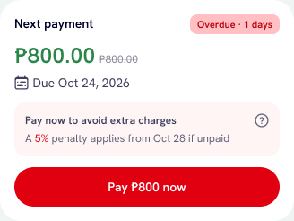
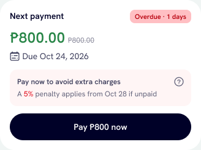

# Update U-2026-11-26 · Home payment card: overdue button becomes navy

> 中文：首页还款卡片在逾期状态下的按钮（“Pay ₱… now”）从红色改为 navy 底、白字，和未到期、今天到期一致。徽标和到期日仍是红色。
> 这是已交付的 rebrand 包（`phi_h5_025-handoff`，2026-11-25）之后的一个单独更新，原包内容不变。

**Design owner, 2026-11-26.** On the Home payment card, the overdue button ("Pay ₱800 now") is now the navy button
(`--button-navy-bg` / `--fg-on-emphasis`), the same as before the due date and on the due date. The red "Overdue · N days" badge, the red
due date and the penalty box don't change.

Figma: `kYyNV2MgxvH1w9bJ46A3yx`, PaymentCard `Status=Due` / `Overdue` / `Overdue coupon` (the Home frame's card is `11134:13498`).
The button is `Button Size=Medium, Variant=Navy` there now (it was `Variant=Destructive`).

| Before | After |
|---|---|
|  |  |

## What it changes in `phi_h5_025`

It takes back two edits of the delivered package, both decided on 2026-11-24 (decision F) and marked structural (owner-approved):

| Edit | File | Delivered | This update |
|---|---|---|---|
| E400 | `src/pages/HomePage/Home/HomeComposite.module.css` | added `.repaymentFooter button[data-overdue='true'] { background: var(--button-destructive-bg); color: var(--button-destructive-fg); }` | **removed**: the overdue button keeps the `.repaymentFooter button` look, which E403 already made navy |
| E543 | `src/pages/HomePage/Home/HomeComposite.tsx` | gave the pay button `data-overdue={repayment.isRepaymentOverdue}` (only E400 used it) | **taken back**: the button is `<button onClick={onOpenPayment} type="button">` again, as in production |

So decision F is replaced: Home no longer has any structural change for the pay button. Nothing else changes: the badge and due
date keep their own `data-overdue` (on the `<strong>` elements, from production), and E403 (navy) stays.

After this update these two places are exactly what production had before the package, apart from E403 and the other token edits.

## How to apply

`overdue-cta-navy.patch` is a git patch made on 0d9bdd4 with the whole delivered package applied (commit A). Neither the motion patch
(commit B) nor step 8 (commit C) touch these lines, so it applies after any of them.

```bash
cd "$REPO"
git apply --check "$U/overdue-cta-navy.patch" && git apply "$U/overdue-cta-navy.patch"
git commit -am "style(rebrand): navy pay button on the overdue Home payment card"
```

- **Package already applied** (the usual case): run the lines above.
- **Package not applied yet**: apply the package as its README says (commits A, B, C), then this patch as a fourth commit.
- **`git apply --check` fails** (the code moved): make the two edits by hand from the table above. If the E400 rule or the
  `data-overdue` on the button isn't there, that edit is already done; don't guess anything else.

## Verify

1. `npx tsc --noEmit`, `npm run type-check`, `npm run build`, `npm test` pass (no test checks the pay button's colour or `data-overdue`).
2. `grep -n "data-overdue" src/pages/HomePage/Home/HomeComposite.tsx` shows only the two `<strong>` lines (badge and due date), not the button.
3. Home with a repayment overdue (`repayment.isRepaymentOverdue` true): the pay button is navy with a white label; the badge and the due date
   are still red. Not overdue: unchanged (navy).

## Prompt for the developers' AI

```text
Apply the PeraSure rebrand update U-2026-11-26 (Home payment card: overdue pay button becomes navy) to phi_h5_025.
The update folder holds README.md and overdue-cta-navy.patch. Read README.md in full first and follow it.

Setup:
  export U=<absolute path to the update folder>
  export REPO=<absolute path to the phi_h5_025 checkout that has the rebrand package applied>
  In $REPO: clean working tree.

Rules:
- Visual change only. It takes back edits E400 and E543 of the delivered package and nothing else.
- Run git apply --check first. If it fails, make the two edits by hand from the README's table; if an edit is already done, say so.
  Never change anything else, and never guess.
- One commit: style(rebrand): navy pay button on the overdue Home payment card

When done, run the README's "Verify" list and report: whether the patch applied or was done by hand, the grep result, the test results
and the commit hash.
```
